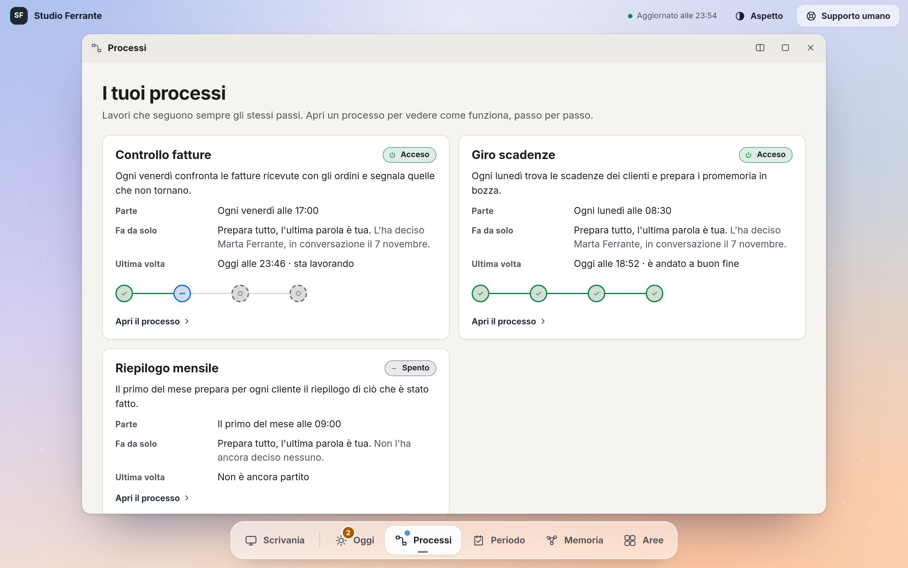

# Redacy

**Trasforma Claude o ChatGPT in un agente sempre attivo per il tuo studio.** Sa dove stanno i tuoi dati, li tiene in ordine, porta avanti i lavori che si ripetono e ti mostra tutto in un pannello sul tuo computer.

Gratuito, per Claude Code e per Codex. Ti serve solo l'abbonamento a Claude o a ChatGPT che usi già.

*In English: a free plugin that turns Claude or ChatGPT into an always-on agent for a small professional firm. It knows where your data lives, keeps it tidy, runs the jobs that repeat, and shows everything in a dashboard on your own computer. The plugin speaks Italian.*


## Cosa fa per te

- **Mette ordine.** Segna dove stanno dati e procedure, e riordina una cartella con un piano che approvi tu. Non cancella niente, e basta dirgli «rimetti tutto com'era» per tornare indietro.
- **Crea i tuoi agenti.** Un agente AI per ogni lavoro (scadenze, fatture, pratiche), ognuno con la sua memoria e i suoi limiti.
- **Ripete i lavori uguali.** Il lavoro che fai ogni settimana diventa un processo a passi fissi, che può partire da solo a un orario. Il passo che conta resta tuo.
- **Impara da te.** Ciò che gli insegni o gli correggi resta scritto: la volta dopo lo sa già.
- **Ti fa vedere tutto.** Una scrivania con cinque finestre: cosa aspetta te, i processi, il periodo, la memoria, chi si occupa di cosa. E un bottone di stop.

## Per chi è

Commercialisti, studi tecnici, consulenti e piccole aziende con lavori che si ripetono e dati sparsi tra cartelle, mail e fogli. Non serve saper programmare: gli parli in italiano.

## Come si installa

Claude Code:

```
claude plugin marketplace add Redacy/redacy-plugin
claude plugin install redacy@redacy
```

Codex (0.164 o successivo):

```
codex plugin marketplace add Redacy/redacy-plugin
codex plugin add redacy@redacy
```

Serve Python 3 sul computer, nient'altro da installare. Funziona su macOS, Windows e Linux.

## Come si parte

Apri Claude Code o Codex nella cartella del tuo studio, o in una cartella vuota, e scrivi `/redacy:inizia`. Su Codex scrivi: «usa la skill redacy:inizia».

In una decina di minuti `inizia` prepara la cartella, ti chiede quali lavori vuoi affidare a un agente e dove stanno dati e procedure, crea i primi agenti e apre il pannello. I tuoi file restano dove sono.

## I comandi

I primi tre sono quelli che usi di più. Gli altri li chiama l'agente quando servono, o li chiedi tu a parole.

| Comando | Cosa fa |
|---|---|
| `/redacy:inizia` | Prepara la cartella, ti intervista, crea i primi agenti e apre il pannello. |
| `/redacy:giro-del-giorno` | Ti dice da dove partire oggi, cosa aspetta te e cosa è fermo. |
| `/redacy:pannello` | Accende il pannello e ti dà l'indirizzo. |
| `/redacy:riordina-cartella` | Mette in ordine una cartella con un piano file per file. Sposta solo dopo il tuo sì e si può annullare. |
| `/redacy:ordina-dati` | Segna in memoria dove stanno i tuoi dati e le tue procedure. |
| `/redacy:crea-workspace` | Crea un agente AI per un lavoro nuovo. |
| `/redacy:crea-grafo` | Trasforma un lavoro che si ripete in un processo a passi fissi. |
| `/redacy:programma` | Fa partire un processo da solo a un orario. |
| `/redacy:pianifica-periodo` | Costruisce con te l'obiettivo del periodo e le cose da fare. |
| `/redacy:impara` | Salva ciò che gli insegni o gli correggi. |
| `/redacy:collega-sensore` | Ti guida a collegare posta, calendario, archivio o gestionale, in sola lettura. |

## Il pannello



Una pagina sola, sul tuo computer. Si apre con una frase («2 cose aspettano te») e cinque finestre vive: un clic ne apre una, su schermi larghi ne tieni due affiancate, e ogni cosa si apre fino al file da cui viene. Il lavoro si chiede all'agente: dove serve, la pagina ti dà la frase da scrivergli. L'unico bottone che agisce è lo stop di un processo in corso.

Nome, colori, sfondo e ordine delle finestre si adattano al tuo studio: basta chiederlo all'agente.

## I tuoi dati restano tuoi

- Lavora solo nella cartella che scegli. Il pannello si vede solo dal tuo computer.
- Non raccoglie dati, non ha telemetria e non parla con nessun server di Redacy: vedi [PRIVACY.md](PRIVACY.md).
- I testi che legge passano dal servizio AI che usi già (Claude o ChatGPT), alle sue condizioni.
- Non sposta un file senza il tuo sì e non ne cancella mai.
- Una persona rilegge il risultato prima che esca. Soldi, atti legali e invii restano tuoi.
- Gli agenti nascono al livello più prudente e non cambiano da soli.

## Buono a sapersi

- **Lavori programmati.** Per far partire un processo da solo, `programma` usa le attività programmate di Claude o le automazioni di Codex.
- **Su Codex.** `inizia` ti dà una riga da lanciare una volta nel terminale: finisce la cartella e accende il pannello. I controlli automatici partono dopo che li approvi con `/hooks`, una volta per cartella.
- **Su Windows.** Controlla che Python ci sia davvero: `python --version` deve rispondere `3.x`. Il supporto a Windows è recente: se qualcosa non va, scrivici.

## Serve una mano?

Il bottone «Supporto umano» del pannello ti porta da noi, su [redacy.com](https://redacy.com). Se vuoi che lo impostiamo insieme sul tuo studio, o un agente gestito da noi, partiamo da lì. Per un difetto del plugin apri una [segnalazione](https://github.com/Redacy/redacy-plugin/issues).

## Licenza

MIT, vedi [LICENSE](LICENSE). Versione 0.4.2.
